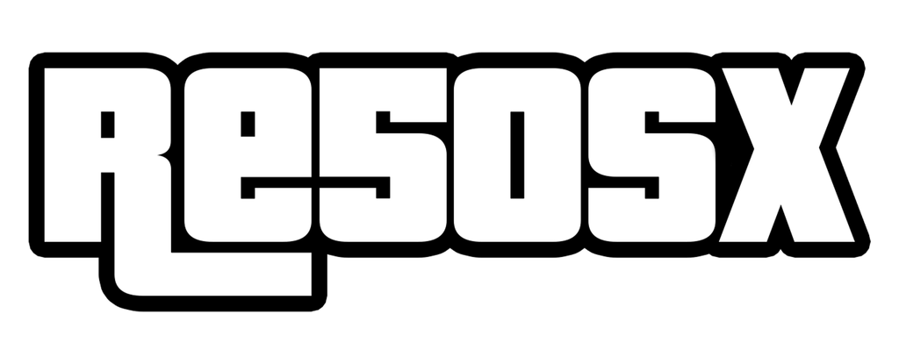

<p align="center">
  
</p>

re5OSX turns the **GTA V WebAssembly build** into a native Mac app. Your Mac compiles the game's WebAssembly to
Apple silicon machine code, and the game's Direct3D 11 graphics run on Metal, with no browser in between. You bring
your own copy of the game; re5OSX ships none of it.

<br>

## What you get

- One app. Open re5OSX, choose your game folder and press Install. About 7 minutes later the game opens, and from
  then on re5OSX goes straight into it.
- The game runs as compiled code and draws with Metal, with MetalFX upscaling.
- DualSense, DualShock, Xbox, Switch Pro and other gamepads work without setup, alongside mouse and keyboard.
- Mods: small Luau scripts that run inside the game. You write and test them in re5OSX Studio, an editor that opens
  in your browser.
- GTA Online between re5OSX players, who find each other and play together directly, with no servers in between.
- Keep the game's 20 GB on one Mac and stream its files to your other Macs on the same network.

## Requirements

- A Mac with Apple silicon (M1 or later) and macOS 14 Sonoma or later.
- Your copy of the GTA V web build: the folder with `b` and `data` inside.
- About 2 GB of free space for the compiled game, on top of the game itself.
- Apple's Command Line Tools. If they are missing, re5OSX asks macOS to install them; it is free and takes a few
  minutes.

## Install

1. Download `re5OSX.dmg` from [Releases](../../releases) and drag **re5OSX** to Applications.
2. Open it. macOS will say it is from an unidentified developer the first time: Control-click re5OSX, choose
   **Open**, then **Open** again.
3. Choose your game folder. If it is on an external drive, macOS asks whether re5OSX may use it; choose **Allow**.
4. Press **Install**. When it finishes, the game opens.

Everything re5OSX makes lives in `~/Library/Application Support/re5OSX`: your saves, settings, the menu art and
sounds, and the compiled game. Delete that folder and the app to remove re5OSX completely.

## How it works

re5OSX can't include the game's code, so it ships everything else and compiles the game on your Mac.

| Part | Where it comes from |
|---|---|
| The renderer, runtime, menus, mods, controller and sound support | Built once and included in re5OSX.app, ready to link |
| The game's code | Translated from your `game.wasm` to C and compiled on your Mac with Apple's Command Line Tools |

Install joins the two into a signed app inside re5OSX's own folder, and re5OSX opens it from there. After an
update, Install runs again, but it only recompiles what changed, so it takes seconds.

The details (wasm2c, the Direct3D 11 to Metal translation, memory, threads, streaming) are in
[docs/design.md](docs/design.md).

## Build from source

You need Xcode 26 or later, [mise](https://mise.jdx.dev) (it installs Rust and the other tools on first use), and a
game folder with the build's original `game.wasm`. The build reads it to generate the code that connects the app to
the game.

```bash
cd app
export RE5OSX_GAME_DIR=/path/to/game
mise run macos:download
```

That makes `app/target/download/re5OSX.app` and `re5OSX.dmg`. For development, `mise run macos:build` makes an app
with the game compiled straight in, and `mise run test` runs the tests. [app/README.md](app/README.md) lists every
crate and task.

## Documentation

- [docs/design.md](docs/design.md): how re5OSX works, and why it is built this way.
- [docs/mods.md](docs/mods.md): writing mods, and re5OSX Studio.
- [docs/online.md](docs/online.md): playing GTA Online with other re5OSX players.
- [docs/streaming.md](docs/streaming.md): sharing the game's files between Macs.

## License

re5OSX is free software under the [GNU General Public License v3.0](LICENSE); see [NOTICE](NOTICE) for where its
code comes from.

Grand Theft Auto V is a trademark of Rockstar Games and Take-Two Interactive. re5OSX is an independent project and is
not affiliated with, endorsed by, or connected to either of them. It contains no game files or code from them.
